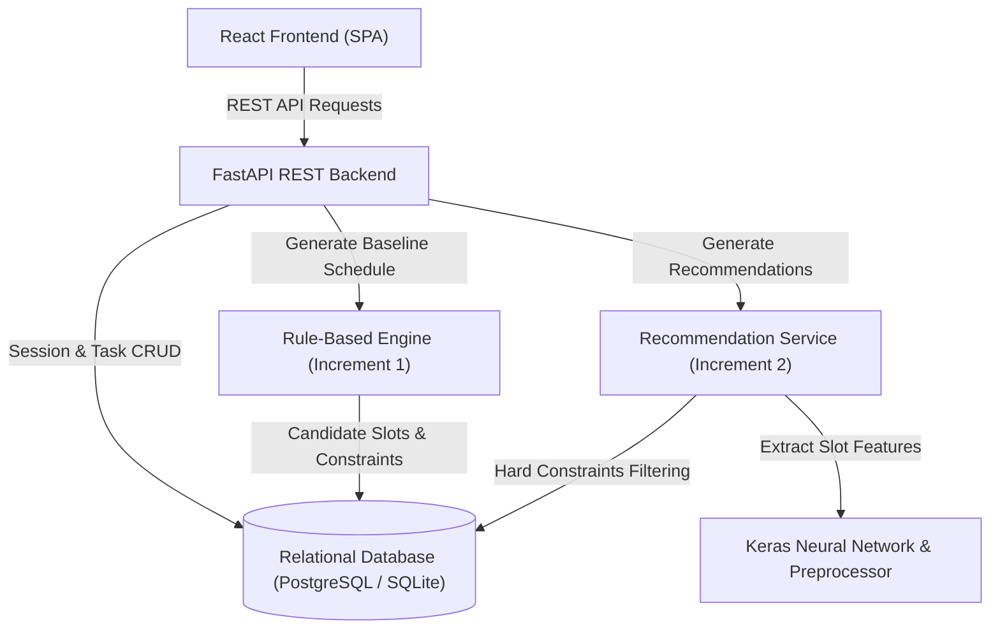
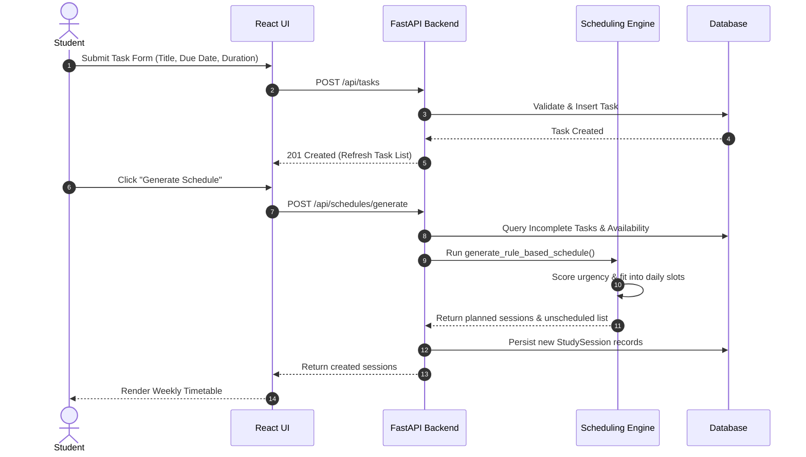
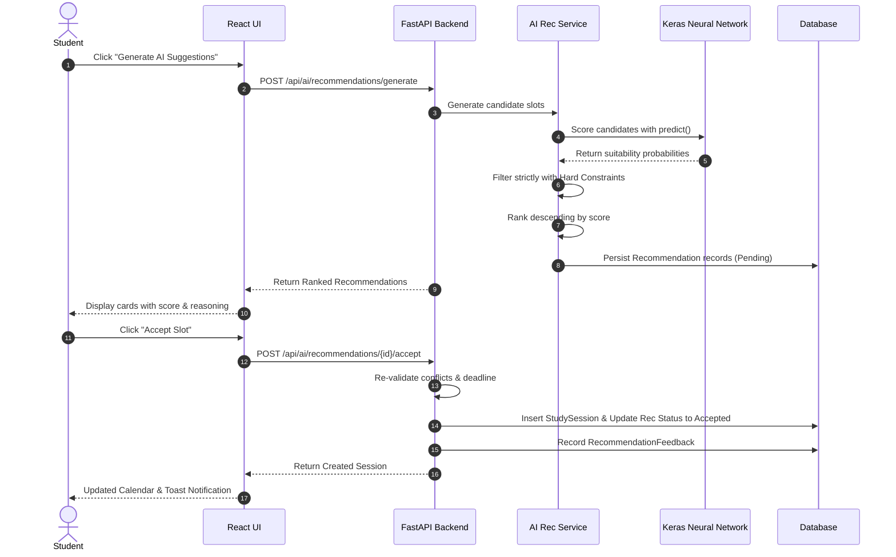
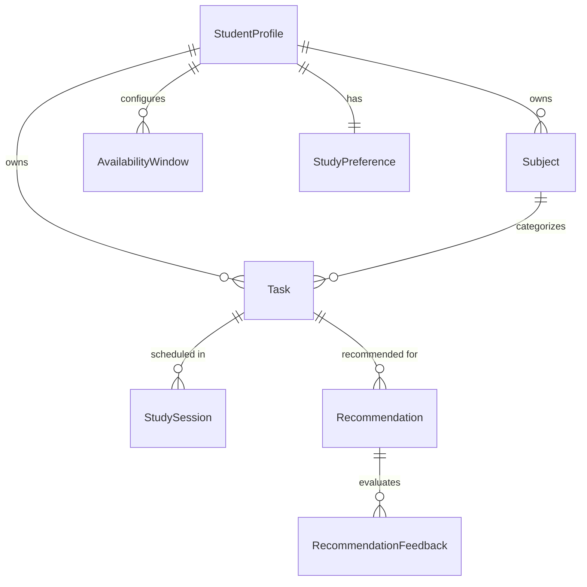

# System Architecture Document — AI-Powered Study Planner

## 1. Architectural Overview

The **AI-Powered Study Planner** is a full-stack academic productivity platform designed with a clean separation of concerns across a modern Single-Page Application (React + TypeScript + Vite + Tailwind CSS), a modular REST API backend (FastAPI + SQLAlchemy + Alembic), and an isolated Machine Learning pipeline (TensorFlow/Keras + scikit-learn).

The system implements an incremental software architecture:
- **Increment 1 (Core Study Planner)**: Conventional deterministic rule-based scheduling engine, full task & subject management, session tracking, calendar views, dashboard metrics, and in-app deadline reminders.
- **Increment 2 (AI Scheduling Recommendations)**: Offline training and runtime inference pipelines that evaluate candidate study slots, score them using a Keras Neural Network, and apply hard constraint filtering to generate recommendations.

---

## 2. Core Modules Description

### Module A: Student Profile & Study Preferences
- **Entities**: `StudentProfile`, `StudyPreference`, `AvailabilityWindow`
- **Responsibilities**: Stores the student's name, configured timezone, preferred session duration (default: 45 min), break duration (default: 15 min), and maximum daily study limit (default: 240 min). Manages recurring weekly active availability windows (Monday through Sunday) with start and end times.

### Module B: Subject Management
- **Entity**: `Subject`
- **Responsibilities**: Manages academic courses and subjects with custom color accents and descriptions. Enforces referential integrity to prevent deleting a subject with linked tasks unless explicitly cleared or reassigned.

### Module C: Task Management
- **Entity**: `Task`
- **Responsibilities**: Handles assignments, revision, readings, and practice tasks. Enforces positive durations, deadline relationships, priority levels (`Low`, `Medium`, `High`), and execution status (`Pending`, `In Progress`, `Completed`). Tracks scheduled versus completed minutes.

### Module D: Rule-Based Scheduling Engine (Increment 1)
- **Files**: `backend/app/scheduling/rules.py`, `candidate_slots.py`, `constraints.py`, `engine.py`
- **Responsibilities**:
  1. Retrieves all incomplete tasks and student availability windows within a planning horizon.
  2. Calculates a deterministic priority score combining deadline urgency, priority weighting, and task duration.
  3. Slices remaining task requirements into session blocks based on preferred duration.
  4. Identifies non-overlapping candidate slots spaced with configured breaks.
  5. Enforces daily study limits and deadline cutoffs.
  6. Transparently reports tasks that cannot fit before their deadline in an `unscheduled_tasks` report.

### Module E: Calendar and Study Sessions
- **Entity**: `StudySession`
- **Responsibilities**: Provides daily and weekly timetable views of planned study blocks. Allows students to mark sessions as completed (recording actual study time), skip sessions, and maintain separation between session-level and task-level completion.

### Module F: Dashboard and Progress Tracking
- **Responsibilities**: Computes and displays today's sessions, tasks due within 72 hours, overdue tasks, pending/completed task counts, total planned/completed study duration, and a 7-day weekly progress bar chart.

### Module G: In-App Reminders
- **Responsibilities**: Evaluates approaching sessions (next 4 hours), approaching deadlines (next 24 hours), and overdue tasks, presenting them in a responsive dropdown alert bell with urgency badges.

### Module H & I: ML Dataset & Training Pipeline (Increment 2)
- **Files**: `backend/app/ml/data_preparation.py`, `features.py`, `train.py`, `evaluate.py`
- **Responsibilities**:
  1. Generates a reproducible synthetic dataset with 1,500 candidate slot observations.
  2. Features: `task_priority`, `task_type`, `estimated_duration`, `hours_until_deadline`, `day_of_week`, `slot_start_hour`, `daily_workload_scheduled`, `slot_duration`.
  3. Preprocessing: `StandardScaler` on numerical features, `OneHotEncoder` on categorical features.
  4. Architecture: Deep Sequential Neural Network with Dropout regularization and Sigmoid suitability output.
  5. Compares against `DummyClassifier` and `LogisticRegression` baselines, recording precision, recall, F1, and ROC-AUC.

### Module J & K: AI Recommendation Service & UI Feedback (Increment 2)
- **Files**: `backend/app/services/recommendation_engine.py`, `recommendation_service.py`
- **Responsibilities**:
  1. Generates candidate availability slots.
  2. Evaluates each candidate slot using the saved Keras model.
  3. **Applies hard constraint validation** (slots after deadline, overlapping slots, and slots exceeding daily limits are strictly discarded regardless of ML score).
  4. Ranks candidates and presents recommendations with feature explanations.
  5. Allows students to Accept (re-validates and books `StudySession`) or Decline, persisting user feedback in `recommendation_feedback`.

---

## 3. Data Flows

### Flow A: Creating and Scheduling a Task

### Flow B: AI Suggestions and Acceptance

---

## 4. Database Schema Relationships

